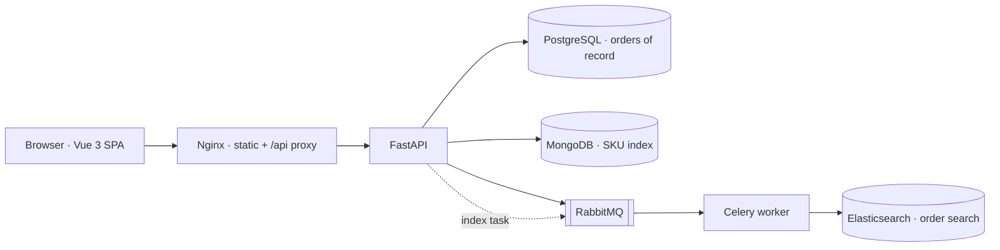

<div align="center">

# 🛍️ BuyMore

[](https://github.com/SohanAjayVernekar/buymore/actions/workflows/ci.yml)
[](LICENSE)


**E-Commerce Order Management & Search — full-stack proof of concept**

`FastAPI` · `Vue 3` · `PostgreSQL` · `MongoDB` · `Elasticsearch` · `RabbitMQ + Celery` · `Docker`

A five-screen storefront + admin suite where product and order data flows through a
queued, eventually-consistent indexing pipeline — built to the supplied BuyMore
design reference: mint canvas, blue navigation, pastel editorial cards.


</div>

---

## ✨ Highlights

- **Five complete screens** — storefront, cart checkout, order details, admin order-search dashboard, and product catalog
- **Server-side pagination** — 6 products per page, powered by a paginated API envelope (`items / total / page / total_pages`)
- **Queued sync pipeline** — PostgreSQL commit → RabbitMQ → Celery → Elasticsearch indexing (the "Option A" queued dual-write strategy)
- **Order search that actually searches** — full-text Elasticsearch queries filtered by status, date range, and order value
- **Editorial-grade UI** — animated banners, floating product art, scroll-reveal sections, sliding tab indicators, springy micro-motion
- **Accessible by design** — keyboard-navigable custom dropdowns, ARIA-labelled dialogs, full `prefers-reduced-motion` support
- **One-command setup** — a single `docker compose up` migrates, seeds, and reconciles every store

## 🖥️ The five screens

| Screen | Route | What it does |
| --- | --- | --- |
| Storefront | `/` | Editorial banners, featured products, category tabs, filters, paginated grid |
| Checkout | `/checkout` | Cart review, address form, order placement |
| Order details | `/admin/orders/:id` | Line items, totals, status timeline, sync panel |
| Order search | `/admin/search` | KPI cards, faceted filters, paginated results table |
| Product catalog | `/admin/catalog` | CRUD table with a sectioned modal editor (JSON attributes/variants) |

## 🏗️ Architecture



**Sync strategy (scoped deliberately):** a queued variation of dual-write — the API
commits to PostgreSQL, then publishes an indexing task to RabbitMQ. The Celery
worker consumes it and writes to Elasticsearch. It is **eventually consistent**,
not a distributed transaction. There is no polling job, CDC, or outbox — and no
authentication, payment, or shipping integration; this is a local POC matching
the assignment scope.

## 🚀 Quick start

**Requirements:** Docker Engine with Compose v2 · ~4 GB free memory

```bash
git clone https://github.com/SohanAjayVernekar/buymore.git
cd buymore
cp .env.example .env
docker compose up --build -d
docker compose logs -f setup     # watch migrate + seed run once
```

Open **http://localhost:15174** — the one-shot `setup` service creates the SQL
schema, MongoDB SKU index, and Elasticsearch mapping, then seeds and reconciles
all orders before the API and worker start.

## 🔌 Local services

| Service | Address |
| --- | --- |
| Storefront | http://localhost:15174 |
| API docs (Swagger) | http://localhost:18002/docs |
| RabbitMQ console | http://localhost:25675 |
| PostgreSQL | `localhost:15434` |
| MongoDB | `localhost:27020` |
| Elasticsearch | http://localhost:19202 |

Stores bind to localhost only. Development credentials come from `.env.example`;
override them via environment variables as needed.

```bash
docker compose ps                               # container health
docker compose logs --tail=50 api worker        # recent API + worker logs
docker compose down                             # stop, keep data volumes
```

## 🔎 API overview

| Method & path | Purpose |
| --- | --- |
| `GET /api/products` | Paginated products — `page`, `page_size`, `max_price`, `q`, `category` |
| `GET /api/products/{id}` | Single product |
| `POST /api/products` · `PUT /api/products/{id}` | Catalog CRUD (admin) |
| `POST /api/orders` | Place an order (writes PG + Mongo, queues index task) |
| `GET /api/orders/{id}` | Order details |
| `POST /api/search/orders` | Elasticsearch-backed search with facets |

## 📁 Project layout

```
buymore/
├── backend/
│   ├── app/            # FastAPI app: routes, models, sync (RabbitMQ publish)
│   ├── app/sync/       # Celery worker + Elasticsearch indexer
│   └── scripts/        # migrate + seed one-shots
├── frontend/
│   ├── src/
│   │   ├── views/      # Shop, Checkout, OrderDetails, Search, Catalog
│   │   ├── components/ # ProductArt, SelectMenu, …
│   │   └── style.css   # full design system + animation layers
│   └── nginx.conf      # SPA fallback + /api proxy (+ optional local TLS)
├── docs/               # design notes
└── docker-compose.yml  # 8 services, one network, named volumes
```

## 🛠️ Optional: host development

```bash
cp .env.example .env
docker compose up -d postgres mongo elasticsearch rabbitmq

python3 -m venv backend/.venv
source backend/.venv/bin/activate
pip install -r backend/requirements.txt

set -a; . ./.env; set +a
cd backend
python -m scripts.migrate
python -m scripts.seed
uvicorn app.main:app --reload --port 18002
```

<details>
<summary><b>Optional: local <code>buymore.com</code> with a trusted HTTPS padlock</b></summary>

```bash
# 1. point the domain at your machine
echo '127.0.0.1 buymore.com' | sudo tee -a /etc/hosts
echo '::1 buymore.com'       | sudo tee -a /etc/hosts

# 2. issue a locally-trusted certificate (https://mkcert.app)
mkcert -install
mkdir -p frontend/certs
cd frontend/certs
mkcert -cert-file buymore.com.pem -key-file buymore.com-key.pem \
  buymore.com localhost 127.0.0.1 ::1
cd ../..

# 3. restart nginx — it already listens on 443 when certs are present
docker compose up -d frontend
```

Certificates are git-ignored; never commit `frontend/certs/`.
</details>

## 📝 Notes

- Product illustrations are local SVG components — no image service required.
- Google Fonts is optional; system fonts remain usable offline.
- Containers, network, and volumes use the `buymore-poc` Compose project name.
- All services are unauthenticated by design — run this locally, not on the public internet.

## 📄 License

Released under the [MIT License](LICENSE) — © 2026 Sohan Ajay Vernekar.
